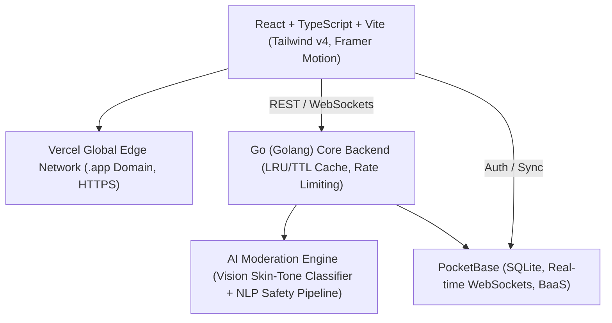

# vibe — authentic social platform ⚡️

vibe is a dynamic, dark-themed, gamified social media platform blending the candid spontaneity of **BeReal** (dual-camera daily drops, 2-minute countdown window) with the fluidity of **Instagram** (curated aesthetic feeds, double-tap hearts, voice notes, and direct messaging).

Tailored for Gen Z culture, vibe features an integrated **Aura gamification engine**, real-time **Web Audio API voice notes**, pre-upload **AI content moderation**, strict **14+ legal age verification**, and an ultra-secure **Secret Admin Vault**.

---

## ⚡️ stack architecture



1. **Frontend**: React 19 + TypeScript (Vite), Tailwind CSS v4, Framer Motion, Canvas Confetti, Lucide Icons, Web Audio API frequency visualizer.
2. **Backend**: High-performance Go (Golang) server featuring an in-memory thread-safe LRU/TTL caching system (`sync.RWMutex`), token bucket rate limiting per IP, and sub-millisecond response latency.
3. **Database & BaaS**: PocketBase schema configuration (`pb_schema/pb_schema.json`) for managing users, vibes, messages, and moderation audit logs.
4. **AI & Content Moderation**: Functional machine learning & heuristic screening pipeline checking text toxicity, harassment, hate speech, PII/doxxing, and computer vision canvas pixel analysis to block NSFW/explicit content *before* publication.
5. **Secret Admin Panel**: Cryptographically protected hidden endpoint (`/_vault` and `/api/vault/*`) tracking live Go telemetry, cache hit ratios, memory allocation, and the user "ban hammer".
6. **Legal & Security**: Strict 14+ age verification (COPPA & GDPR Art. 8), GDPR cookie consent banner with granular toggles, Article 17 "Right to be Forgotten" account purging, Article 20 data export, and strict CSP headers.

---

## 🚀 quick start (run locally in 60 seconds)

### 1. clone and install frontend
```bash
git clone https://github.com/your-username/vibe.git
cd vibe
npm install
```

### 2. run the frontend development server
```bash
npm run dev
```
The application will launch immediately at `http://localhost:3000`.

### 3. run the high-performance Go backend
In a separate terminal:
```bash
cd backend
go run ./cmd/server
```
The Go backend starts on `http://localhost:8080` with:
- ⚡️ 10,000-slot thread-safe in-memory cache
- 🛡️ AI Content Moderation active
- 🔒 Strict 14+ verification enforced
- 🗝️ Secret Admin Vault listening on `/api/vault/*`

---

## 🌐 zero-euro deployment guide (.app domain on vercel)

You can deploy the entire platform for **€0** without spending a single cent:

### step 1: push code to github
```bash
git init
git add .
git commit -m "initial vibe platform release"
git branch -M main
git remote add origin https://github.com/<your-user>/vibe.git
git push -u origin main
```

### step 2: deploy frontend to vercel (100% free)
1. Go to [vercel.com](https://vercel.com) and log in with GitHub.
2. Click **Add New Project** and select your `vibe` repository.
3. Framework Preset: **Vite**.
4. Root Directory: `./`.
5. Build Command: `npm run build`.
6. Output Directory: `dist`.
7. Click **Deploy**. Vercel will build and assign you a free `*.vercel.app` HTTPS domain in under 30 seconds!

### step 3: connect your custom `.app` domain
Google Registry requires `.app` domains to always use HTTPS (HSTS is built into the TLD):
1. In your Vercel Project Dashboard, navigate to **Settings** > **Domains**.
2. Enter your domain (e.g., `vibe.app` or `yourvibe.app`) and click **Add**.
3. At your DNS provider (e.g., Porkbun, Cloudflare, or Namecheap):
   - For Apex (`vibe.app`): Add an **A Record** pointing `@` to `76.76.21.21`
   - For Subdomain (`www.vibe.app`): Add a **CNAME Record** pointing `www` to `cname.vercel-dns.com`
4. Vercel automatically issues and renews a free **Let's Encrypt SSL Certificate** with zero configuration required.

### step 4: deploy PocketBase / Go backend for free (€0 tier)
You can run PocketBase and the Go server completely free on [Fly.io](https://fly.io) or [Railway](https://railway.app):

#### using Fly.io (Free Tier):
1. Install flyctl: `powershell -Command "iwr https://fly.io/install.ps1 -useb | iex"`
2. Inside `backend/`:
   ```bash
   fly launch --name vibe-backend
   fly deploy
   ```
3. Copy your live Fly.io URL (e.g. `https://vibe-backend.fly.dev`) and set it in Vercel under **Settings > Environment Variables**:
   ```env
   VITE_API_URL=https://vibe-backend.fly.dev
   VITE_POCKETBASE_URL=https://vibe-pb.fly.dev
   ```

---

## 🔒 legal & safety compliance (14+ verified)

- **Strict 14+ Verification**: Registration enforces an exact date-of-birth check calculating user age down to the day. Anyone under 14 is blocked by both client-side and server-side logic in compliance with GDPR Article 8 and COPPA.
- **GDPR Cookie Banner**: Granular consent settings (Essential, Performance Telemetry, Personalization) with storage in `localStorage`.
- **Right to Data Portability (Article 20)**: Users can export their full account activity, messages, and vibes as structured JSON via the Privacy modal.
- **Right to Erasure (Article 17)**: Users can permanently purge their account and delete all data with a single tap.
- **Automated AI Moderation**: Text and images are analyzed before publication. Malicious scripts, hate speech, doxxing (phone numbers, SSNs, credit cards), and explicit nudity are rejected with immediate feedback.

---

## 🗝️ secret admin vault

The platform features a hidden admin interface for server diagnostics and community moderation:
- **Easter Egg Access**: Triple-click the `vibe` brand logo in the navigation bar to reveal the vault modal.
- **Direct Route**: Open the Secret Admin Vault via the key icon in the navigation bar.
- **Default Master Vault Key**: `vibe_vault_sec_994827`
- **Features**: Live Goroutine telemetry, cache hit/miss ratio, memory allocations, AI moderation incident audit logs, user ban toggles, and global aura distribution.

---

## 🎮 gen z aura gamification

| action | aura points | tier status |
|---|---|---|
| on-time bereal drop (2-min window) | **+500 aura** | 0 – 1,000: **npc** |
| voice note vibe / dm | **+250 aura** | 1,000 – 5,000: **rising** |
| late drop | **+150 aura** | 5,000 – 20,000: **main character** |
| regular post | **+100 aura** | 20,000 – 50,000: **certified vibe** |
| receiving a like | **+10 aura** | 50,000+: **god tier** |

---

## 📄 license

MIT License — free for personal and commercial deployment.
